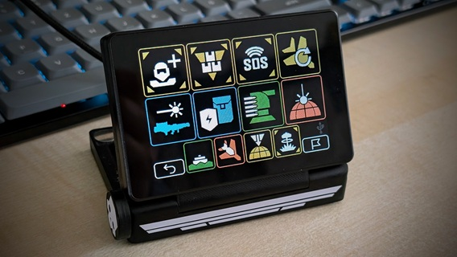

# HD2 Macropad

A very flexible and easy-to-use macropad for HELLDIVERS&trade; 2 for live configuration on each drop into combat with individual loadouts.

> [!IMPORTANT]
> **CrowPanel Advance 7.0 fork.** This is Evan's public fork of [Erik Lembke's HD2 Macropad](https://github.com/unic8s/hd2_macropad) (`unic8s/hd2_macropad`) for the Elecrow CrowPanel Advance 7.0 (DIS02170A). The primary first install is one Windows program, `HD2MacropadLink-v1.2.6.exe`, for firmware `v1.9.1-cp7.2`. Setup, purchase, troubleshooting, flash, update, and recovery: [docs/crowpanel/README.md](docs/crowpanel/README.md). Maintainer checklist: [docs/crowpanel/MAINTAINER.md](docs/crowpanel/MAINTAINER.md).
>
> Buy the **CrowPanel Advance 7.0**, SKU DIS02170A (ESP32-S3, 16 MB flash, 8 MB PSRAM, 800x480). This firmware is not for the CrowPanel Basic, and not for the CrowPanel Advance 7 ESP32-P4. Shop links and the notes on cases are in the CrowPanel guide.
>
> Evan is a beginner at 3D printing and is working on a printable case. He will share it if and when he has it worked out. There is no date, and no shop for it.
>
> The CrowPanel port and the notes in this fork are AI-assisted. Evan tests the port on real hardware. This is not an official unic8s release. Erik Lembke remains the original author. The on-device About screen still credits Oliver G. (@Gore66) and Erik L. (@unic8s) and still links to `github.com/unic8s/hd2_macropad`.
>
> Licence: [CC BY-NC-SA 4.0](LICENSE.md).
>
> Donations stay with the original author. The Buy Me a Coffee button in the Support section below is Erik Lembke's existing link (`https://www.buymeacoffee.com/unic8`). `.github/FUNDING.yml` still names GitHub Sponsors `unic8s` and Buy Me a Coffee `unic8`. This fork does not add a donation, sponsor, or payment destination. Evan does not want money from the project.
>
> Upstream HD2 Macropad, by Erik Lembke, targets the JC3248W535. This fork does not. It runs on the Elecrow CrowPanel Advance 7.0. Do not flash a JC3248 install image onto the CrowPanel. The original project remains at [unic8s/hd2_macropad](https://github.com/unic8s/hd2_macropad).

> [!NOTE]
> **That upstream project requires the [JC3248W535](https://s.click.aliexpress.com/e/_DneMCLR). This CrowPanel fork does not.**
>
> **[@wokka1](https://github.com/wokka1) maintains a different fork for another Elecrow 7 inch display.**

Get the game on [PC](https://store.steampowered.com/app/553850/HELLDIVERS_2/), [Playstation&trade;](https://www.playstation.com/games/helldivers-2/)

Based on an affordable IoT platform device with a capacitive touchscreen it's very handy for a PC, Playstation&trade; since it's connected via Bluetooth or USB as a keyboard input device.

> HELLDIVERS and Playstation are registered trademarks of SONY INTERACTIVE ENTERTAINMENT LLC.

## Videos

[Video preview](https://www.youtube.com/watch?v=zbW8vrxIuko) on YouTube.

[Demo on PC](https://www.youtube.com/watch?v=QH1CfI5M_fw) on YouTube.

## Instructions

> [!TIP]  
> For instructions to get your own device and installation - please visit the [Wiki](https://github.com/unic8s/hd2_macropad/wiki)
> There you will also find lots of details and how to configure and use the device.

> [!IMPORTANT]  
> The device is only able to connect to the Playstation&trade; via USB.
> It's not able to connect to the Playstation&trade; via Bluetooth directly.
> We're currently working on the [BT2USB bridge](https://github.com/unic8s/bt2usb_bridge) which plugs into the USB port of a Playstation&trade; directly and connects to the HD2 Macropad via Bluetooth.

## Support

We're pleased with your feedback so far and we try to keep up with your good ideas for new features. Thanks to all of you participating on our journey.
If you enjoy the project and want to support our private work feel free to make a small donation.

## Screenshots

### Setup

### Presets & User-defined icons

### Config

### Game (example configuration)

### Mission

### Manual input - if you want to put it on your wrist for cosplayers or more intense experience while diving

#### Simple for a clean look

#### List your selected stratagems and see your inputs get resolved instantly

## Credits and special thanks

- [Icon Set](https://github.com/nvigneux/Helldivers-2-Stratagems-icons-svg) from [@nvigneux](https://github.com/nvigneux)
- [Demo project](https://github.com/NorthernMan54/JC3248W535EN) from [@NorthernMan54](https://github.com/NorthernMan54)

## Disclaimer and copyright
> This is a private opensource project and is not associated in any kind with SONY INTERACTIVE ENTERTAINMENT LLC.
> SONY INTERACTIVE ENTERTAINMENT LLC is not responsible for any function and content that is related to this project.
> Related assets in this project are either produced by us and free to use for non-commercial usage or respectively published by the owners mentioned here.
